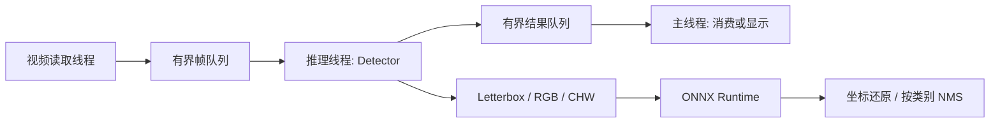

# YOLO C++ Detector

面向 CPU 的 C++17 目标检测部署工程：ONNX Runtime、OpenCV、Letterbox、按类别 NMS、有界视频流水线、可观测丢帧及性能报告。保留可选 GPU/TensorRT 实验代码，但当前稳定版本的验收范围是 CPU。

## 验证状态

真实模型、图片、视频、队列关闭和信号退出均在 WSL Ubuntu 24.04 验证。Release、Sanitizer 和真实回归的最终结果见 [本地验收报告](docs/local_validation.md)。不将合成后处理测试称为检测精度评测，不承诺固定 FPS 或加速倍数。

## 架构与技术栈



- C++17、CMake、std::thread、mutex、condition_variable、RAII。
- OpenCV 负责图像、视频、预后处理及 JSON 报告；ONNX Runtime 负责模型执行。
- CPU 版本不要求 CUDA Toolkit；开启 `ENABLE_TENSORRT` 才寻找 CUDA/TensorRT 开发环境。
- 固定输入：float32 `[1,3,640,640]`；固定输出：float32 `[1,84,8400]`；80 个类别。其他格式明确拒绝。

## 构建与测试

需要已有 GCC/CMake/Python3/OpenCV 开发环境和 ONNX Runtime C++ SDK。本机验证使用 ORT 1.21.1；已有 GPU SDK 也可运行 CPU provider。脚本不安装软件、不联网下载依赖。

```bash
export ONNXRUNTIME_ROOT=/path/to/existing/onnxruntime
bash scripts/check.sh release
bash scripts/check.sh sanitize
```

若 SDK 位于用户主目录下的 `onnxruntime-linux-x64-*`，脚本可自动发现；存在多个版本时建议明确设置变量。构建并行最多 2。手动构建：

```bash
cmake -S . -B build-local -DCMAKE_BUILD_TYPE=Release \
  -DENABLE_TENSORRT=OFF -DONNXRUNTIME_ROOT="$ONNXRUNTIME_ROOT"
cmake --build build-local -j2
ctest --test-dir build-local --output-on-failure
```

## 本地直接演示

本机已有模型和视频时：

```bash
bash scripts/demo.sh
```

默认无界面、最多 150 帧、阻塞队列；输出 `results/demo.json`。新克隆需要自行提供合法取得的 YOLO11n ONNX 权重和测试视频。权重、视频、运行时 SDK 和构建产物不上传 Git。

图片检测：

```bash
build-local/yolo_detector --image input.jpg --output annotated.png \
  --model models/yolo11n.onnx --classes data/coco.txt --report results/image.json
```

视频流水线与顺序基线：

```bash
build-local/yolo_detector --video test.mp4 --headless --mode pipeline \
  --queue-policy block --queue-size 3 --max-frames 150 --report results/pipeline.json
build-local/yolo_detector --video test.mp4 --headless --mode sequential \
  --max-frames 150 --report results/sequential.json
```

`--show` 开启图形窗口；没有图形会话时使用默认 headless。`--warmup` 默认 5，预热不计入性能样本。`YOLO_ORT_INTRA_OP_THREADS` 控制 ORT intra-op 线程数，默认 3。

`--queue-policy drop-oldest` 会优先保留新帧并记录丢帧，适合研究实时新鲜度；读取文件时不模拟摄像头帧率。不可把读取帧数当作完整推理帧数。默认 block 适合完整处理离线视频。SIGINT/SIGTERM 触发协作关闭，底层视频读取或模型调用的中断延迟受依赖实现限制。

## 测量口径

- `output_fps`：实际消费帧数 / 处理阶段总时间；不含模型加载和预热。
- `inference`：ORT Run；`backend_api` 包含张量封装和结果复制。
- `queue_wait`：读取完成到推理开始；阻塞入队等待也计入。
- `end_to_end`：读取完成到结果消费，包含排队、处理及可选显示，不含采集/解码之前时间。
- 均值、极值和计数覆盖全程；p50/p95 超过一万样本时仅覆盖最近一万帧，统计内存有界。
- 每个队列容量只约束队列中的帧，不包括正在解码、推理及消费的少量帧；帧内存也取决于分辨率。

性能数字和局限见验收报告；历史实验保留在 [旧性能记录](docs/performance_benchmark.md)，不能将历史与当前不同负载数据直接比较为优化收益。

## 工程目录

`src/main.cpp` 参数与入口；`pipeline.cpp` 生命周期；`detector.cpp` 检测流程；`yolo_processing.cpp` 可独立测试的处理逻辑；`ort_backend.cpp` 模型执行；`include/thread_safe_queue.h` 队列；`tests/` 自动化测试；`scripts/` 本地入口。

[学习指南](docs/学习指南.md) · [架构说明](docs/architecture.md) · [依赖和模型说明](docs/dependencies.md)

## 未验证边界

GPU/CUDA provider、TensorRT 构建、FP16/INT8 精度与速度、摄像头、Windows 原生构建、大数据集 mAP 均未完成本轮验收。可选 TensorRT 代码属于实验路径，不包含在 CPU 成功声明内。第三方 SDK 和模型遵循各自许可证；本地模型的身份哈希不等于已证明其下载来源和导出过程。
